# Introdução ao Docker e Docker Compose

Trabalho da disciplina de **Redes e Administração de Sistemas** do Curso Técnico em Informática Integrado ao Ensino Médio do IFSP, campus Campos do Jordão, seguindo o material de apoio do professor: [RAS-Docker](https://github.com/CesarAugusto88/RAS-Docker).

O trabalho tem duas etapas:

1. **Docker:** instalar o Docker em uma máquina virtual com Ubuntu Server, escrever uma aplicação web em **Python** com o framework **Flask** e executá-la dentro de um **container**, acessando a página pelo navegador (seções 1 a 11).
2. **Docker Compose:** evoluir a aplicação para três containers, integrando o Flask a um banco de dados **MySQL** e a um servidor web **Apache** que funciona como proxy reverso (seções 12 a 18).

- **Ambiente:** Ubuntu Server sobre Oracle VirtualBox
- **Imagem base:** `python:3.14-slim`
- **Serviços do Compose:** `mysql:8.0`, aplicação Flask e `httpd:2.4`

---

## Sumário

1. [O que é Docker](#1-o-que-é-docker)
2. [Preparação da máquina virtual](#2-preparação-da-máquina-virtual)
3. [Instalação do Docker](#3-instalação-do-docker)
4. [Validação com hello-world](#4-validação-com-hello-world)
5. [Estrutura do projeto](#5-estrutura-do-projeto)
6. [A aplicação Flask](#6-a-aplicação-flask)
7. [O Dockerfile](#7-o-dockerfile)
8. [Construção da imagem](#8-construção-da-imagem)
9. [Execução do container](#9-execução-do-container)
10. [Testes de acesso](#10-testes-de-acesso)
11. [Evolução da aplicação](#11-evolução-da-aplicação)
12. [Orquestração com Docker Compose](#12-orquestração-com-docker-compose)
13. [Estrutura e variáveis de ambiente](#13-estrutura-e-variáveis-de-ambiente)
14. [Serviços do Compose](#14-serviços-do-compose)
15. [Apache como proxy reverso](#15-apache-como-proxy-reverso)
16. [Integração com o banco de dados](#16-integração-com-o-banco-de-dados)
17. [Execução e tabela de alunos](#17-execução-e-tabela-de-alunos)
18. [Testes de acesso com o Compose](#18-testes-de-acesso-com-o-compose)
19. [Comandos úteis](#19-comandos-úteis)
20. [Problemas encontrados](#20-problemas-encontrados)

---

## 1. O que é Docker

Docker é uma plataforma de código aberto que empacota uma aplicação junto de todas as suas dependências em uma unidade isolada e portável, chamada **container**.

A diferença para uma máquina virtual é o nível em que a virtualização acontece: a máquina virtual virtualiza o **hardware**, enquanto o container virtualiza o **sistema operacional**.

| Container | Máquina virtual |
|---|---|
| Compartilha o kernel do host | Tem kernel próprio |
| Leve, na casa dos MB | Pesada, na casa dos GB |
| Inicia em segundos | Inicia em minutos |
| Isolamento em nível de processo | Isolamento completo |

Três conceitos que não podem ser confundidos:

- **Imagem:** template imutável com a aplicação e suas dependências. Não executa sozinha.
- **Container:** instância em execução de uma imagem.
- **Dockerfile:** arquivo de texto com as instruções para construir uma imagem.

A arquitetura tem três peças: o **cliente** (o comando `docker` que você digita), o **daemon** (o processo que de fato faz o trabalho) e o **registry** (o repositório de imagens, sendo o Docker Hub o público padrão).

---

## 2. Preparação da máquina virtual

A máquina virtual roda **Ubuntu Server** no VirtualBox. Dois ajustes foram necessários.

**Rede.** O adaptador ficou em **NAT** o tempo todo, que basta para a VM alcançar a internet. Em NAT a VM fica numa rede privada do VirtualBox (o `ip a` mostra `10.0.2.15` na interface `enp0s3`) e o Windows não alcança esse endereço. Para resolver, foram criadas duas regras de **redirecionamento de portas** em Configurações → Rede → Avançado → Redirecionamento de Portas:

| Regra | Porta do host | Porta da VM | Para quê |
|---|---|---|---|
| SSH | 2222 | 22 | acesso remoto ao terminal |
| Flask | 5000 | 5000 | acesso à aplicação web |

Com isso, `localhost:2222` no Windows chega na porta 22 da VM, e `localhost:5000` chega na 5000.

**Acesso remoto por SSH.** Com a regra acima, a conexão a partir do terminal do Windows fica:

```bash
ssh aluno@localhost -p 2222
```

O destino é `localhost`, o próprio Windows, e não o IP da VM, porque quem atende a porta 2222 é o VirtualBox, que repassa a conexão. Isso resolve o problema de não conseguir colar código dentro da janela do VirtualBox.

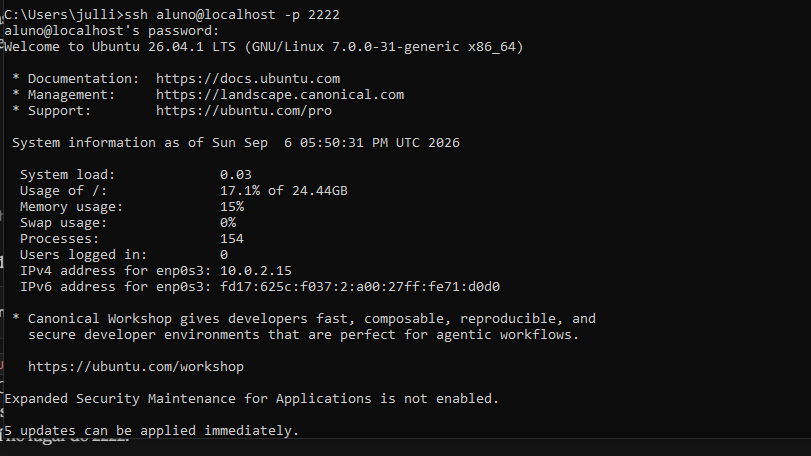

**Repositórios antigos.** A imagem da VM disponibilizada no laboratório já trazia arquivos de repositório desatualizados, que precisam ser removidos antes de instalar pela fonte oficial:

```bash
sudo rm /etc/apt/sources.list.d/docker.list
sudo rm /etc/apt/sources.list.d/docker.sources
sudo apt-get update
```

---

## 3. Instalação do Docker

Seguindo a [documentação oficial](https://docs.docker.com/engine/install/ubuntu/), na modalidade de instalação a partir do repositório. Depois de configurar a chave GPG e adicionar o repositório:

```bash
sudo apt-get install docker-ce docker-ce-cli containerd.io \
     docker-buildx-plugin docker-compose-plugin
```

Saída:

```
The following NEW packages will be installed:
  containerd.io docker-buildx-plugin docker-ce docker-ce-cli
  docker-ce-rootless-extras docker-compose-plugin pigz
0 upgraded, 7 newly installed, 0 to remove and 5 not upgraded.
Need to get 99.8 MB of archives.
After this operation, 382 MB of additional disk space will be used.
```

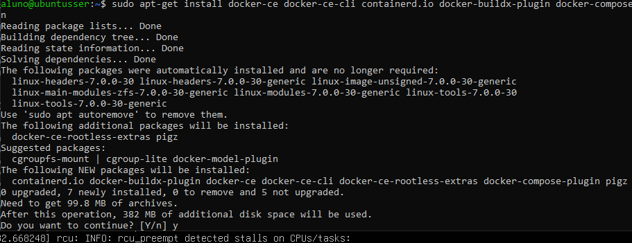

Foram 7 pacotes e cerca de **382 MB** adicionais em disco.

> Os comandos do Docker precisam de `sudo`, ou o usuário precisa estar no grupo `docker`:
> ```bash
> sudo usermod -aG docker $USER
> ```
> É preciso sair e entrar de novo na sessão para o grupo valer.

---

## 4. Validação com hello-world

```bash
docker --version
```

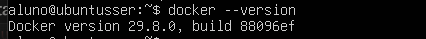

Isso confirma só o cliente. Para verificar que o daemon também está de pé e consegue criar containers:

```bash
sudo docker run hello-world
```

Saída:

```
Unable to find image 'hello-world:latest' locally
latest: Pulling from library/hello-world
4f55086f7dd0: Pull complete
d5e71e642bf5: Download complete
Digest: sha256:5dd0d3e6e255913fc30f90b9f2b1d359cc2cbdb48090cc4b65f1676e203243cc
Status: Downloaded newer image for hello-world:latest

Hello from Docker!
This message shows that your installation appears to be working correctly.

To generate this message, Docker took the following steps:
 1. The Docker client contacted the Docker daemon.
 2. The Docker daemon pulled the "hello-world" image from the Docker Hub.
 3. The Docker daemon created a new container from that image which runs the
    executable that produces the output you are currently reading.
 4. The Docker daemon streamed that output to the Docker client, which sent it
    to your terminal.
```

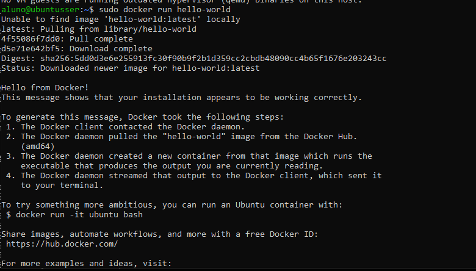

Essa saída descreve exatamente a arquitetura da seção 1: o cliente falou com o daemon, o daemon buscou a imagem no Docker Hub porque ela não existia localmente, criou o container e devolveu a saída ao terminal.

---

## 5. Estrutura do projeto

```bash
tree projeto-flask
```

```
projeto-flask
├── app
│   ├── app.py
│   └── requirements.txt
└── Dockerfile

2 directories, 3 files
```

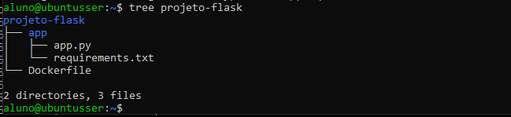

Manter o código dentro de `app/` não é só organização. Isso permite copiar **primeiro** o `requirements.txt` para a imagem e só **depois** o código, o que aproveita muito melhor o cache de camadas do Docker.

Em seguida, a imagem base foi baixada:

```bash
docker pull python:3.14-slim
```

```
3.14-slim: Pulling from library/python
3d2c3ff37d4c: Pull complete
d4a378e57055: Pull complete
6310eb16bf42: Pull complete
6bd54ebeb5af: Pull complete
194f274eb493: Download complete
d58edce158f3: Download complete
Digest: sha256:cad9a2c871761c413caa6fdd6441c783451e740a48aaeba60ae62a8b53525ef6
Status: Downloaded newer image for python:3.14-slim
```

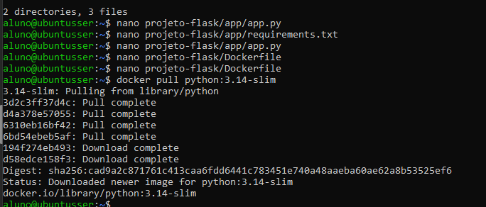

A variante `slim` traz só o necessário para rodar Python, seguindo a boa prática de construir imagens leves.

Estado do repositório local nesse ponto:

```bash
docker image ls
```

```
IMAGE                ID             DISK USAGE   CONTENT SIZE   EXTRA
hello-world:latest   5dd0d3e6e255       25.9kB         9.49kB   U
python:3.14-slim     cad9a2c87176        191MB         48.6MB
```

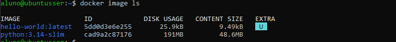

---

## 6. A aplicação Flask

`app/app.py`, primeira versão:

```python
from flask import Flask

app = Flask(__name__)

@app.route('/')
def home():
    return """
    <h1>Minha primeira aplicação Flask</h1>
    <p>Aplicação executada dentro de um container Docker!</p>
    """

if __name__ == '__main__':
    app.run(host='0.0.0.0', port=5000)
```

Dois detalhes são decisivos para funcionar dentro de um container:

- **`host='0.0.0.0'`** faz o servidor aceitar conexões de qualquer interface de rede. Com o padrão `127.0.0.1`, a aplicação só responderia a requisições vindas de dentro do próprio container e o mapeamento de portas não teria efeito nenhum.
- **A porta 5000** precisa ser a mesma no `EXPOSE` do Dockerfile e no `-p` do `docker run`.

`app/requirements.txt`:

```
flask
```

---

## 7. O Dockerfile

```dockerfile
FROM python:3.14-slim

WORKDIR /app

COPY app/requirements.txt .
RUN pip install --no-cache-dir -r requirements.txt

COPY app/ .

EXPOSE 5000

CMD ["python", "app.py"]
```

O que cada instrução faz:

| Instrução | Função |
|---|---|
| `FROM` | define a imagem base |
| `WORKDIR` | define o diretório de trabalho dentro da imagem |
| `COPY` | copia arquivos do host para a imagem |
| `RUN` | executa comandos durante a construção |
| `EXPOSE` | documenta a porta em que a aplicação escuta |
| `CMD` | comando executado quando o container inicia |

**Por que copiar o `requirements.txt` antes do código?** Cada instrução gera uma camada. Como as dependências mudam muito menos que o código, deixá-las em uma camada anterior faz com que alterar o `app.py` não obrigue a reinstalar o Flask a cada build. O `--no-cache-dir` do pip evita gravar arquivos temporários na camada, deixando a imagem menor.

---

## 8. Construção da imagem

```bash
docker build -t minha-flask .
```

Saída:

```
[+] Building 9.3s (10/10) FINISHED                            docker:default
 => [internal] load build definition from Dockerfile                    0.0s
 => => transferring dockerfile: 208B                                    0.0s
 => [internal] load metadata for docker.io/library/python:3.14-slim     0.0s
 => [internal] load .dockerignore                                       0.0s
 => => transferring context: 2B                                         0.0s
 => [1/5] FROM docker.io/library/python:3.14-slim@sha256:cad9a2c8...    0.1s
 => [internal] load build context                                       0.0s
 => => transferring context: 407B                                       0.0s
 => [2/5] WORKDIR /app                                                  0.0s
 => [3/5] COPY app/requirements.txt .                                   0.0s
 => [4/5] RUN pip install --no-cache-dir -r requirements.txt            7.9s
 => [5/5] COPY app/ .                                                   0.0s
 => exporting to image                                                  1.0s
 => => exporting layers                                                 0.6s
 => naming to docker.io/library/minha-flask:latest                      0.0s
 => => unpacking to docker.io/library/minha-flask:latest                0.3s
```

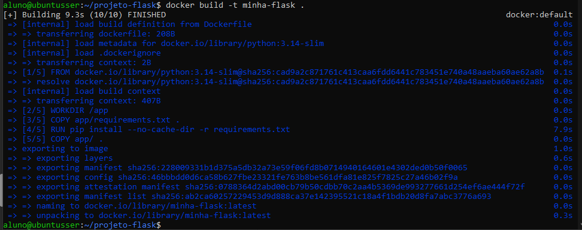

O `-t` dá um nome à imagem e o ponto final indica o **contexto de construção**, ou seja, o diretório cujo conteúdo é enviado ao daemon.

A construção levou **9,3 segundos** e percorreu 10 etapas, das quais as 5 numeradas correspondem às instruções do Dockerfile. A mais demorada foi a instalação do Flask pelo pip, com **7,9 segundos**, que é justamente o motivo de isolá-la em uma camada própria.

---

## 9. Execução do container

```bash
docker run -d -p 5000:5000 --name meu-flask minha-flask
docker ps
```

```
ca0fc1323196e98dc2806548255e90b2d9c84b1578671363e9a9f4577cd10ece

CONTAINER ID   IMAGE         COMMAND           CREATED          STATUS
ca0fc1323196   minha-flask   "python app.py"   24 seconds ago   Up 23 seconds

PORTS                                         NAMES
0.0.0.0:5000->5000/tcp, [::]:5000->5000/tcp   meu-flask
```

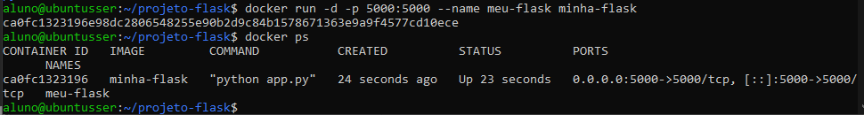

| Opção | Função |
|---|---|
| `-d` | executa em segundo plano (detached) |
| `-p 5000:5000` | mapeia a porta do host para a porta do container |
| `--name` | dá um nome legível ao container |

O `docker ps` mostra o container com status `Up` e o mapeamento `0.0.0.0:5000->5000/tcp` ativo.

Imagens locais depois do build:

```bash
docker image ls
```

```
IMAGE                ID             DISK USAGE   CONTENT SIZE   EXTRA
hello-world:latest   5dd0d3e6e255       25.9kB         9.49kB   U
minha-flask:latest   ab2ca6025722        211MB         51.8MB
python:3.14-slim     cad9a2c87176        191MB         48.6MB
```

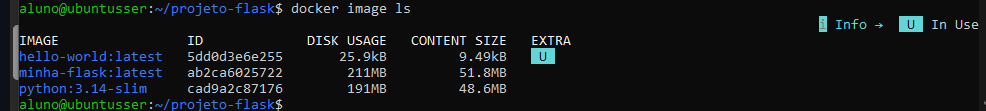

Como o container roda em segundo plano, a saída dele não aparece no terminal. Para ver o que a aplicação registrou:

```bash
docker logs meu-flask
```

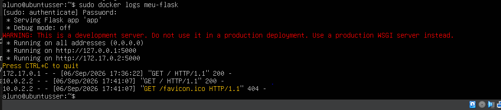

A saída mostra o Flask escutando em `0.0.0.0` e registra a origem de cada requisição, o que deixa as duas camadas de rede visíveis: `172.17.0.1` é o `curl` de dentro da VM, `10.0.2.2` é o navegador do Windows chegando pela NAT do VirtualBox.

A `minha-flask` aparece com 211 MB contra 191 MB da imagem base, mas o espaço realmente ocupado a mais é de apenas **20 MB**. Todas as camadas herdadas do Python são compartilhadas fisicamente entre as duas imagens. Esse é o efeito do sistema de camadas.

---

## 10. Testes de acesso

**Dentro da VM, pelo terminal:**

```bash
curl http://localhost:5000
```

```html
    <h1>Minha primeira aplicação Flask</h1>
    <p>Aplicação executada dentro de um container Docker!</p>
```

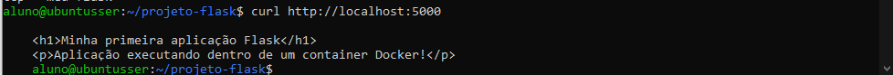

**No navegador do Windows,** em `http://localhost:5000`, graças à regra de redirecionamento:


---

## 11. Evolução da aplicação

Com o fluxo funcionando, a aplicação ganhou as rotas `/sobre` e `/contato`, um menu de navegação compartilhado entre as páginas e uma folha de estilos CSS com tema escuro. O arquivo [`app/app.py`](app/app.py) do repositório já é a versão final da segunda etapa, que acrescenta a rota `/alunos` (seção 16).

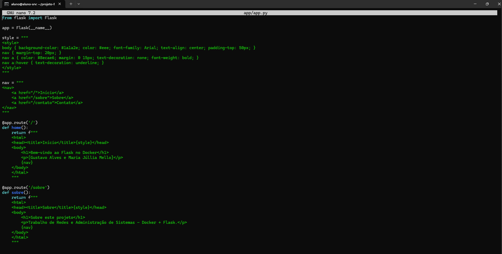

A edição foi feita com o `nano`, direto na máquina virtual:

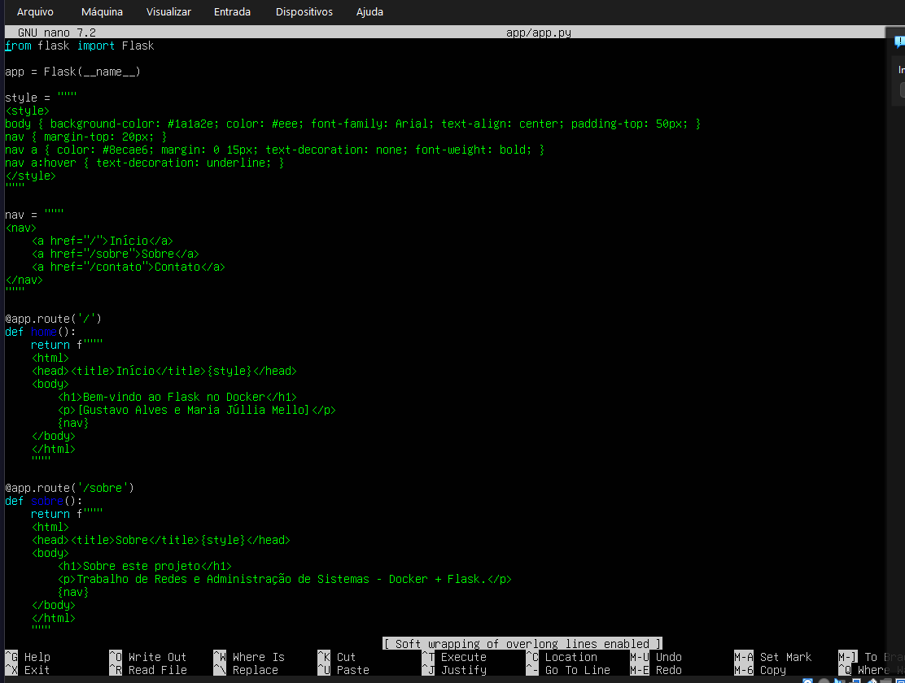

Estrutura adotada: `style` e `nav` ficam em variáveis no topo do arquivo e são interpoladas em cada rota com f-string, evitando repetir o mesmo HTML três vezes.

```python
nav = """
<nav>
    <a href="/">Início</a>
    <a href="/sobre">Sobre</a>
    <a href="/contato">Contato</a>
</nav>
"""

@app.route('/sobre')
def sobre():
    return f"""
    <html>
    <head><title>Sobre</title>{style}</head>
    <body>
        <h1>Sobre este projeto</h1>
        <p>Trabalho de Redes e Administração de Sistemas - Docker + Flask.</p>
        {nav}
    </body>
    </html>
    """
```

Como o código está **dentro da imagem**, editar o arquivo não muda o container que já está rodando. É preciso refazer o ciclo:

```bash
docker stop meu-flask
docker rm meu-flask
docker build -t minha-flask .
docker run -d -p 5000:5000 --name meu-flask minha-flask
```

Esse segundo build foi bem mais rápido, porque só a camada do `COPY app/ .` precisou ser refeita. Todas as anteriores vieram do cache, incluindo a instalação do Flask.

Resultado:

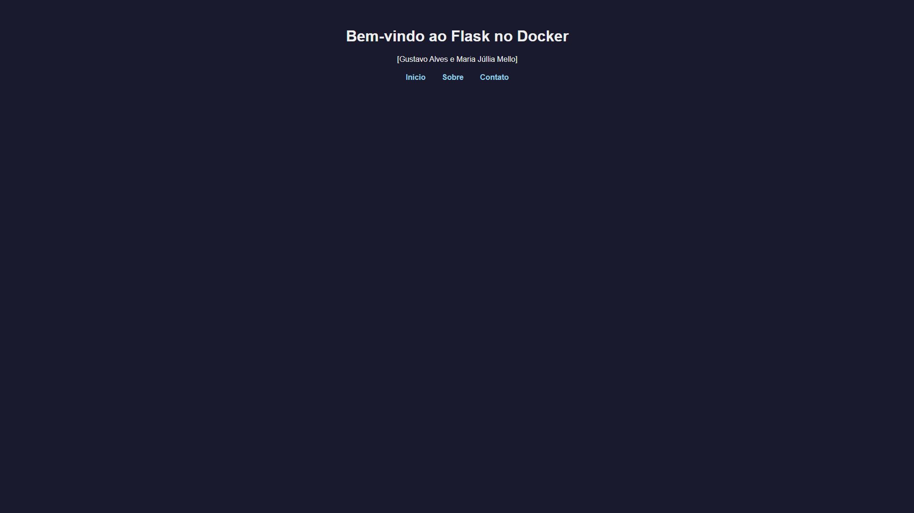

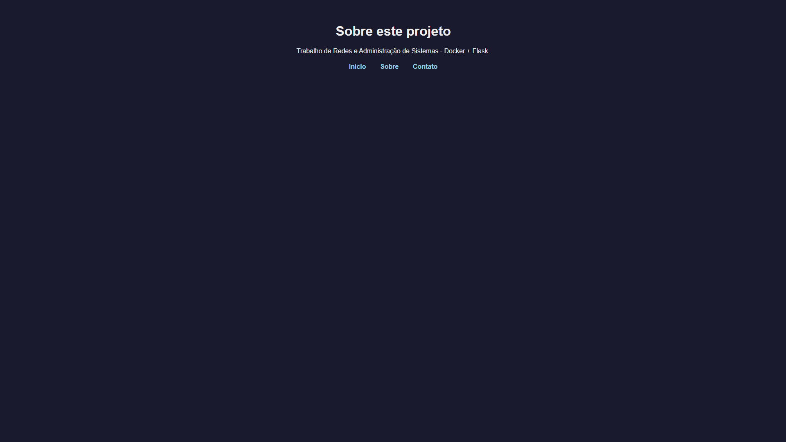

As três páginas ficaram acessíveis pelo menu, o que mostra que o roteamento do Flask funciona normalmente dentro do container e que uma única porta mapeada basta para servir a aplicação inteira.

---

## 12. Orquestração com Docker Compose

Na primeira etapa a aplicação rodava em um único container, criado à mão com `docker build` e `docker run`. Na segunda, o ambiente passa a ter três containers e o **Docker Compose** descreve todos eles em um único arquivo YAML, de onde são construídos, iniciados e encerrados em conjunto.

| Serviço | Imagem | Porta | Função |
|---|---|---|---|
| `server` | `httpd:2.4` | 80 | proxy reverso, ponto de entrada |
| `flask` | construída pelo Dockerfile | 5000 | aplicação web em Python |
| `db` | `mysql:8.0` | 3306 | armazenamento dos dados |

O fluxo de uma requisição é: **navegador → Apache → Flask → MySQL**, e a resposta faz o caminho de volta.

Três recursos do Compose são centrais:

- **Rede interna:** o Compose cria uma rede compartilhada pelos três containers, onde cada um é encontrado pelo **nome do serviço**. O Flask fala com o banco em `db` e o Apache fala com o Flask em `flask`, sem precisar saber IP nenhum.
- **Volume:** área de armazenamento gerenciada pelo Docker, independente do container. Os dados do MySQL ficam nele e sobrevivem à remoção e recriação do container.
- **Variáveis de ambiente:** valores entregues ao container na execução, o que mantém senhas fora do código e da imagem.

O Compose já estava instalado desde a seção 3, porque o pacote `docker-compose-plugin` fazia parte do comando de instalação:

```bash
docker compose version
```

> Use sempre `docker compose`, com espaço. O `docker-compose`, com hífen, é a versão antiga, distribuída como programa separado.

---

## 13. Estrutura e variáveis de ambiente

O container da primeira etapa foi removido para liberar a porta 5000, e os arquivos novos foram criados na raiz do projeto:

```bash
docker stop meu-flask
docker rm meu-flask
cd ~/projeto-flask
touch compose.yaml .env .gitignore httpd.conf
tree -a
```

```
.
├── app
│   ├── app.py
│   └── requirements.txt
├── compose.yaml
├── Dockerfile
├── .env
├── .gitignore
└── httpd.conf

2 directories, 7 files
```

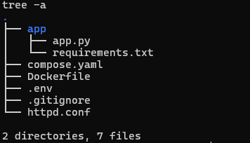

O `-a` do `tree` mostra também os arquivos ocultos, como `.env` e `.gitignore`. O Dockerfile continua o mesmo da seção 7.

**Dependências.** O `app/requirements.txt` ganhou o conector do MySQL, e a versão do Flask foi fixada para que todo build instale exatamente a mesma:

```
Flask==3.1.2
mysql-connector-python
```

**Variáveis de ambiente.** As senhas não ficam no `compose.yaml`. Ficam no arquivo `.env`, que o Compose lê sozinho:

```
MYSQL_ROOT_PASSWORD=sua_senha_root
MYSQL_PASSWORD=sua_senha_flask
```

`MYSQL_ROOT_PASSWORD` é a senha do administrador do MySQL e `MYSQL_PASSWORD` é a do usuário `flaskuser`, usado pela aplicação. O arquivo `.env` **não vai para o repositório**. O `.gitignore` impede isso:

```
.env
__pycache__/
*.pyc
*.swp
```

Na máquina virtual, o acesso ao arquivo também foi restringido ao próprio usuário:

```bash
chmod 600 .env
```

O `.env` não é criptografado. Ele só separa as credenciais da configuração versionada.

---

## 14. Serviços do Compose

O `compose.yaml` define os três serviços, as dependências entre eles e o volume:

```yaml
services:
  db:
    image: mysql:8.0
    restart: unless-stopped
    environment:
      MYSQL_ROOT_PASSWORD: ${MYSQL_ROOT_PASSWORD:?Defina no .env}
      MYSQL_DATABASE: meu_banco
      MYSQL_USER: flaskuser
      MYSQL_PASSWORD: ${MYSQL_PASSWORD:?Defina no .env}
    volumes:
      - mysql_data:/var/lib/mysql
    healthcheck:
      test: ["CMD-SHELL", "mysqladmin ping -h 127.0.0.1 -uroot -p\"$${MYSQL_ROOT_PASSWORD}\" --silent"]
      interval: 10s
      timeout: 5s
      retries: 10
      start_period: 30s

  flask:
    build:
      context: .
    restart: unless-stopped
    environment:
      DB_HOST: db
      DB_PORT: "3306"
      DB_NAME: meu_banco
      DB_USER: flaskuser
      DB_PASSWORD: ${MYSQL_PASSWORD:?Defina no .env}
    volumes:
      - ./app:/app
    ports:
      - "5000:5000"
    depends_on:
      db:
        condition: service_healthy

  server:
    image: httpd:2.4
    restart: unless-stopped
    ports:
      - "80:80"
    volumes:
      - ./httpd.conf:/usr/local/apache2/conf/httpd.conf:ro
    depends_on:
      - flask

volumes:
  mysql_data:
```

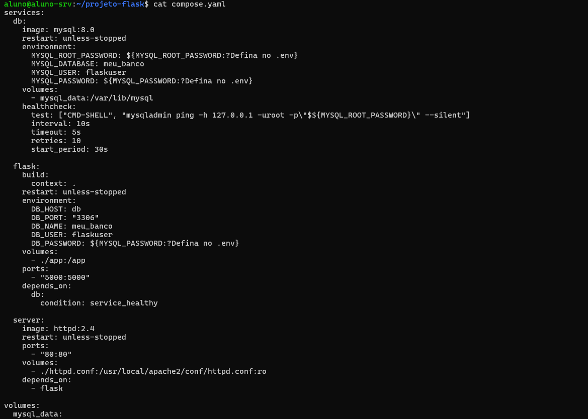

### Serviço `db`

- **Imagem oficial do MySQL.** As variáveis `MYSQL_DATABASE`, `MYSQL_USER` e `MYSQL_PASSWORD` fazem o próprio container criar o banco `meu_banco` e o usuário `flaskuser` na primeira inicialização.
- **`${MYSQL_PASSWORD:?Defina no .env}`** significa: pegue o valor no `.env` e, se ele não existir, interrompa e mostre a mensagem depois do `?`. O texto `Defina no .env` é uma **mensagem de erro**, não a senha.
- **Volume `mysql_data`**, montado em `/var/lib/mysql`. Os registros permanecem mesmo que o container seja removido e recriado.
- **`healthcheck`** executa `mysqladmin ping` de tempos em tempos. Enquanto o MySQL não responde, o serviço é considerado não saudável. O `$$` impede que o Compose substitua a variável ao ler o arquivo, deixando isso para o shell dentro do container.

### Serviço `flask`

- **`build`** com `context: .` constrói a imagem a partir do Dockerfile da raiz, em vez de baixar uma imagem pronta.
- **`DB_HOST: db`** é o nome do serviço do banco na rede interna.
- **`depends_on` com `service_healthy`** faz o Flask esperar o banco passar no `healthcheck` antes de iniciar. Sem isso, o Flask subiria assim que o container do MySQL fosse criado, com o banco ainda não pronto para conexões.
- **`./app:/app`** monta o código local dentro do container. Junto com o `debug=True` do Flask, alterar o `app.py` atualiza a página sem reconstruir a imagem, o contrário do ciclo da seção 11.
- **`ports`** no lugar de `expose`: o material de referência usa `expose`, que só documenta a porta 5000 na rede interna. Como o trabalho também pede o acesso direto ao Flask, a porta é publicada com `"5000:5000"`.

### Serviço `server`

Imagem oficial do Apache, publicando a porta 80. O `httpd.conf` é montado no container em modo somente leitura, indicado pelo `:ro`.

---

## 15. Apache como proxy reverso

O Apache recebe as requisições na porta 80 e as repassa ao Flask. Esse papel se chama **proxy reverso**.

```apache
ServerRoot "/usr/local/apache2"
Listen 80
ServerName localhost

LoadModule mpm_event_module modules/mod_mpm_event.so
LoadModule authz_core_module modules/mod_authz_core.so
LoadModule unixd_module modules/mod_unixd.so
LoadModule log_config_module modules/mod_log_config.so
LoadModule mime_module modules/mod_mime.so
LoadModule proxy_module modules/mod_proxy.so
LoadModule proxy_http_module modules/mod_proxy_http.so

User daemon
Group daemon

TypesConfig conf/mime.types

ErrorLog /proc/self/fd/2
LogLevel warn
CustomLog /proc/self/fd/1 common

<VirtualHost *:80>
    ProxyRequests Off
    ProxyPreserveHost On
    ProxyPass / http://flask:5000/
    ProxyPassReverse / http://flask:5000/
</VirtualHost>
```

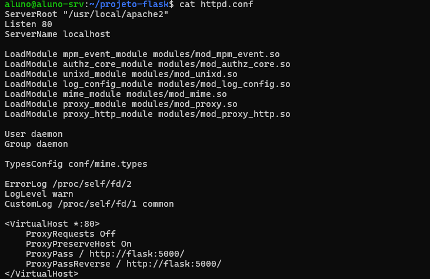

- **Módulos:** só os indispensáveis são carregados, entre eles `mod_proxy` e `mod_proxy_http`, que fazem o encaminhamento.
- **`ProxyPass`** envia toda requisição recebida em `/` para `http://flask:5000/`, usando o nome do serviço na rede interna.
- **`ProxyPassReverse`** ajusta os cabeçalhos das respostas, para que redirecionamentos apontem para o Apache e não para o endereço interno do Flask.
- **`ProxyRequests Off`** desativa o modo de proxy aberto, que permitiria usar o servidor para acessar sites externos.
- **Logs** vão para a saída padrão, e por isso aparecem em `docker compose logs server`.

---

## 16. Integração com o banco de dados

O `app/app.py` manteve o visual e as rotas da primeira etapa e ganhou a rota `/alunos`, com o link correspondente no menu. A conexão lê as credenciais de variáveis de ambiente:

```python
import os
import mysql.connector

def conectar_banco():
    return mysql.connector.connect(
        host=os.environ["DB_HOST"],
        port=int(os.environ.get("DB_PORT", "3306")),
        database=os.environ["DB_NAME"],
        user=os.environ["DB_USER"],
        password=os.environ["DB_PASSWORD"]
    )
```

Nenhuma credencial fica escrita no código. A mesma aplicação pode apontar para outro banco só mudando a configuração.

A rota que consulta os alunos:

```python
@app.route("/alunos")
def alunos():
    conexao = conectar_banco()
    cursor = conexao.cursor(dictionary=True)

    try:
        cursor.execute("SELECT id, nome FROM alunos ORDER BY id")
        registros = cursor.fetchall()

        itens = ""
        for aluno in registros:
            itens += f"<li>{aluno['id']} - {aluno['nome']}</li>"

        return f"""
        <html>
        <head><title>Alunos</title>{style}</head>
        <body>
            <h1>Alunos cadastrados no MySQL</h1>
            <ul>{itens}</ul>
            {nav}
        </body>
        </html>
        """

    finally:
        cursor.close()
        conexao.close()
```

- **`dictionary=True`** devolve cada registro como dicionário, e as colunas são acessadas pelo nome.
- **`finally`** garante que o cursor e a conexão sejam fechados mesmo se a consulta falhar.
- A conexão só é aberta quando a rota é acessada. Por isso o Flask subir sem erro **não prova** que o banco funciona: só o acesso a `/alunos` prova.

As páginas `/sobre` e `/contato` continuam estáticas, e a `/sobre` foi atualizada para descrever a nova arquitetura.

---

## 17. Execução e tabela de alunos

Antes de subir, a configuração foi validada:

```bash
docker compose config
```

Esse comando mostra o arquivo final com as variáveis do `.env` já substituídas. Como isso **expõe as senhas**, a saída não deve ser publicada nem entrar em prints.

```bash
docker compose up -d --build
docker compose ps
```

| Opção | Função |
|---|---|
| `-d` | executa os containers em segundo plano |
| `--build` | força a construção da imagem do Flask |

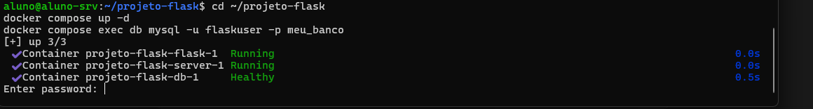

```
NAME                     IMAGE                 COMMAND                  SERVICE   STATUS                    PORTS
projeto-flask-db-1       mysql:8.0             "docker-entrypoint.s…"   db        Up 20 minutes (healthy)   3306/tcp, 33060/tcp
projeto-flask-flask-1    projeto-flask-flask   "python app.py"          flask     Up 20 minutes             0.0.0.0:5000->5000/tcp, [::]:5000->5000/tcp
projeto-flask-server-1   httpd:2.4             "httpd-foreground"       server    Up 16 minutes             0.0.0.0:80->80/tcp, [::]:80->80/tcp
```

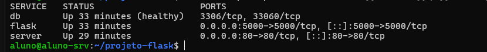

Os três serviços estão em execução e o banco aparece como `healthy`. Só as portas 80 e 5000 estão publicadas na VM. A 3306 do MySQL fica acessível apenas dentro da rede interna do Compose.

**Criação da tabela.** O banco `meu_banco` é criado sozinho, mas as tabelas não. Ela foi criada pelo cliente do MySQL dentro do container:

```bash
docker compose exec db mysql -u flaskuser -p meu_banco
```

```sql
CREATE TABLE alunos (
    id INT AUTO_INCREMENT PRIMARY KEY,
    nome VARCHAR(100) NOT NULL
);

INSERT INTO alunos (nome)
VALUES ('Gustavo Alves Maciel'), ('Maria Júllia Mello de Lima');

SELECT * FROM alunos;
```

```
+----+----------------------------+
| id | nome                       |
+----+----------------------------+
|  1 | Gustavo Alves Maciel       |
|  2 | Maria Júllia Mello de Lima |
+----+----------------------------+
```

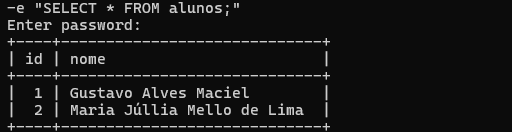

> O `docker compose exec` executa um programa dentro de um container em execução, identificado pelo nome do serviço.

---

## 18. Testes de acesso com o Compose

**Redirecionamento de portas.** A VM continuou em NAT, então foi acrescentada uma terceira regra no VirtualBox, junto com as da seção 2:

| Regra | Porta do host | Porta da VM | Para quê |
|---|---|---|---|
| SSH | 2222 | 22 | acesso remoto ao terminal |
| Flask | 5000 | 5000 | acesso direto à aplicação |
| Apache | 8080 | 80 | acesso pelo proxy reverso |

A porta 8080 foi usada no Windows porque a 80 pode estar ocupada ou exigir administrador.

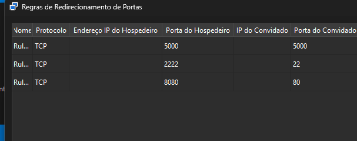

**Dentro da VM, pelo Apache:**

```bash
curl -i http://localhost/alunos
```

```
HTTP/1.1 200 OK
Server: Werkzeug/3.1.9 Python/3.14.10
Content-Type: text/html; charset=utf-8
```

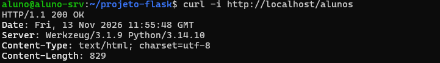

O `200 OK` confirma o caminho completo: o Apache recebeu, repassou ao Flask, o Flask consultou o MySQL e devolveu a página. O cabeçalho `Server` mostra `Werkzeug` porque o proxy repassa a resposta do Flask do jeito que ela chega.

**No navegador do Windows, pelo Apache** (`localhost:8080`):

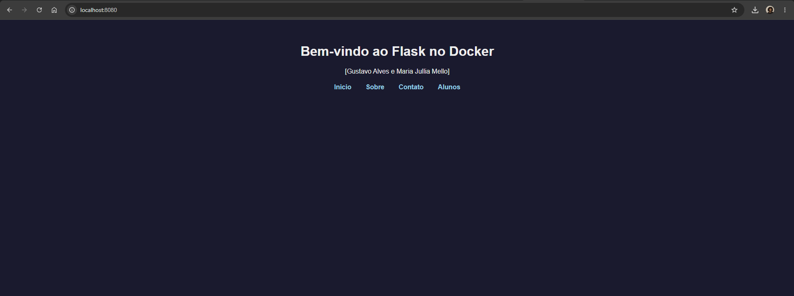

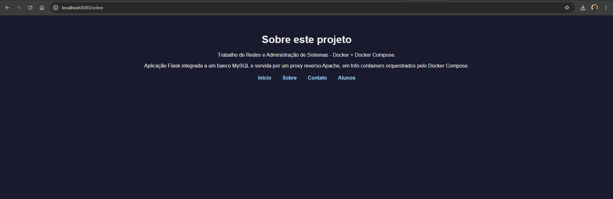

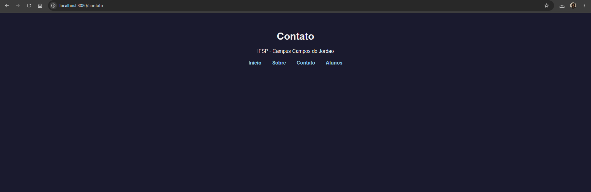

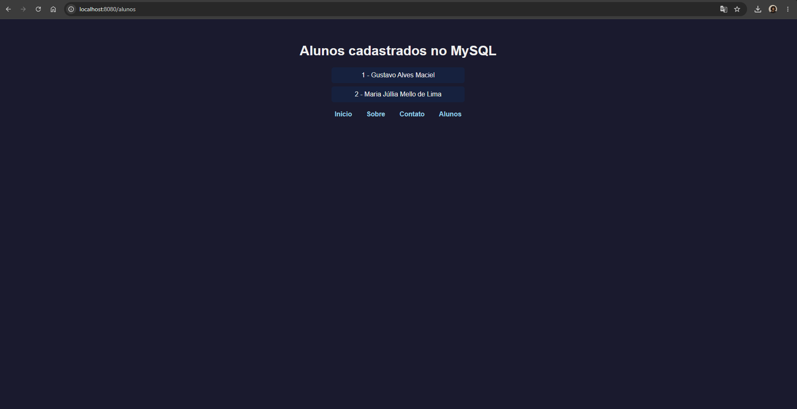

**Direto no Flask, sem passar pelo Apache** (`localhost:5000/alunos`), com os mesmos registros vindos do MySQL:

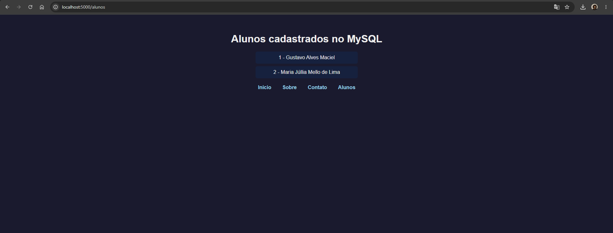

---

## 19. Comandos úteis

```bash
docker --version                  # versão instalada
docker ps                         # containers em execução
docker ps -a                      # todos os containers
docker image ls                   # imagens locais
docker logs meu-flask             # logs do container
docker stop meu-flask             # para o container
docker rm meu-flask               # remove o container
docker rmi minha-flask            # remove a imagem
docker exec -it meu-flask bash    # abre um shell dentro do container
```

Comandos do Docker Compose, sempre dentro da pasta que contém o `compose.yaml`:

| Comando | Função |
|---|---|
| `docker compose up -d --build` | constrói e inicia os serviços |
| `docker compose ps` | lista os serviços e o estado de cada um |
| `docker compose logs -f flask` | acompanha os logs de um serviço |
| `docker compose exec db mysql -u flaskuser -p meu_banco` | abre o MySQL dentro do container |
| `docker compose config` | valida e mostra a configuração final |
| `docker compose down` | para e remove os containers |
| `docker compose down -v` | remove também os volumes, **apagando os dados** |

---

## 20. Problemas encontrados

**A página não abre no navegador do hospedeiro.**
Em NAT a VM alcança a internet, mas o Windows não alcança a VM. O container subia normal, o `docker ps` mostrava `Up` e o `curl` interno respondia, mas o navegador não abria nada. O engano foi procurar o problema no Docker: o `-p 5000:5000` funcionava, o que faltava era a camada de fora, entre Windows e VM. A solução foi o **redirecionamento de portas** no VirtualBox. Trocar para Bridge também resolveria, mas depende da rede do laboratório e o IP muda a cada sessão.

O `docker logs meu-flask` deixa as duas camadas visíveis: requisições de `172.17.0.1` são o `curl` de dentro da VM, vindas do gateway da `docker0`; requisições de `10.0.2.2` são o navegador do Windows, vindas do gateway da NAT do VirtualBox.

**Não dá para colar código dentro da VM.**
O Ubuntu Server não tem interface gráfica e a janela do VirtualBox não compartilha a área de transferência com o Windows. Digitar o `app.py` inteiro no `nano`, com CSS e três rotas, é lento e cheio de erro de digitação. Acessar a VM por um terminal no próprio Windows resolve, porque aí o copiar e colar funciona.

**Editei o app.py mas a página não mudou.**
O código foi copiado para dentro da imagem no `docker build`. O container em execução continua servindo a versão antiga. É preciso parar, remover, reconstruir e executar de novo.

**O `apt-get update` acusa conflito de repositórios.**
Sobraram arquivos antigos em `/etc/apt/sources.list.d`. Remover `docker.list` e `docker.sources` resolve.

**O container está `Up` mas nada responde na porta 5000.**
O Flask estava escutando só em `127.0.0.1`. É preciso declarar `app.run(host='0.0.0.0', port=5000)`.

**`permission denied` ao rodar o docker.**
Usar `sudo` ou adicionar o usuário ao grupo `docker` e reiniciar a sessão.

**O disco da VM enche (`No space left on device`).**
Ao editar o `requirements.txt`, o `nano` não conseguiu salvar. O `df -h /` mostrava o disco de 8,1 GB com 100% de uso. Mais tarde o próprio MySQL recusou criar a tabela, com o erro `Create table/tablespace 'alunos' failed, as disk is full`. A limpeza com `docker system prune -a`, `apt-get clean` e `journalctl --vacuum-size=50M` ajudou pouco, porque as imagens do MySQL, do Apache e do Python somam mais de 1 GB e o banco ainda precisa gravar dados. O `sudo vgs` mostrou que não havia espaço livre no LVM. A solução foi aumentar o disco virtual para 20 GB no VirtualBox, com a VM desligada, e depois fazer o Ubuntu usar o espaço novo:

```bash
lsblk
sudo growpart /dev/sda 3
sudo pvresize /dev/sda3
sudo lvextend -r -l +100%FREE /dev/mapper/ubuntu--vg-ubuntu--lv
df -h /
```

O `growpart` estende a partição, o `pvresize` avisa o LVM e o `lvextend -r` aumenta o volume lógico e o sistema de arquivos de uma vez, sem reiniciar. A falha de gravação também deixou um arquivo temporário `.requirements.txt.swp`, que foi apagado e entrou no `.gitignore`.

**O container `server` não sobe: `address already in use` na porta 80.**
O `db` e o `flask` subiram, mas o Apache do container falhou ao publicar a porta 80. O `sudo ss -tlnp | grep ':80 '` mostrou um Apache instalado direto na VM, fora do Docker, já escutando nela. Dois processos não podem usar a mesma porta. A solução foi parar e desabilitar o serviço da VM, para ele não voltar após um reinício:

```bash
sudo systemctl stop apache2
sudo systemctl disable apache2
docker compose up -d
```

**O acento sumiu no MySQL (`Jllia` no lugar de `Júllia`).**
O terminal dentro do container não estava em UTF-8 e descartou o caractere ao digitar. O registro foi corrigido com um comando executado a partir da VM, com o conjunto de caracteres definido:

```bash
docker compose exec db mysql --default-character-set=utf8mb4 -u flaskuser -p meu_banco -e "UPDATE alunos SET nome='Maria Júllia Mello de Lima' WHERE id=2;"
```

**`no configuration file provided: not found`.**
Depois de uns dias sem abrir a VM, o SSH entrou na pasta pessoal e o Compose procura o `compose.yaml` no diretório atual. Bastou `cd ~/projeto-flask`.

**O print da rota `/alunos` não bate com o código.**
O Chrome traduziu a página automaticamente, mudando "cadastrados" para "matriculados" e "Início" para "Página inicial". O print foi refeito com a tradução desativada.

**Sobre o Compose e as alterações no código.**
O problema de editar o `app.py` e a página não mudar, descrito acima, deixou de existir na segunda etapa: a pasta `app` é montada no container por um volume e o Flask roda com `debug=True`.

---

## Como reproduzir

```bash
git clone https://github.com/mjuspy/introducao-ao-docker.git
cd introducao-ao-docker
```

Crie o arquivo `.env` na raiz, com as suas senhas:

```bash
printf 'MYSQL_ROOT_PASSWORD=sua_senha_root\nMYSQL_PASSWORD=sua_senha_flask\n' > .env
```

Suba os três serviços:

```bash
docker compose up -d --build
docker compose ps
```

Crie a tabela de alunos, digitando a senha de `MYSQL_PASSWORD` quando for pedida:

```bash
docker compose exec db mysql -u flaskuser -p meu_banco
```

```sql
CREATE TABLE alunos (
    id INT AUTO_INCREMENT PRIMARY KEY,
    nome VARCHAR(100) NOT NULL
);
INSERT INTO alunos (nome) VALUES ('Seu Nome');
```

Depois abra `http://localhost` (pelo Apache) ou `http://localhost:5000` (direto no Flask). Se estiver em uma VM em NAT, crie antes as regras de redirecionamento da seção 18 e use `http://localhost:8080` no lugar da porta 80.

Para encerrar:

```bash
docker compose down
```

---

## Referências

- COSTA, C. A. d. M. [RAS-Docker: material de apoio da disciplina](https://github.com/CesarAugusto88/RAS-Docker)
- [Documentação oficial do Docker](https://docs.docker.com)
- [Documentação do Docker Compose](https://docs.docker.com/compose/)
- [Instalação do Docker Engine no Ubuntu](https://docs.docker.com/engine/install/ubuntu/)
- [Docker Hub](https://hub.docker.com)
- [Documentação do Flask](https://flask.palletsprojects.com)
- [Documentação do Python](https://docs.python.org)
- [MySQL Connector/Python](https://dev.mysql.com/doc/connector-python/en/)
- [Apache HTTP Server: mod_proxy](https://httpd.apache.org/docs/2.4/mod/mod_proxy.html)
- VITALINO, J. F. N.; CASTRO, M. A. N. *Descomplicando o Docker*. Rio de Janeiro: Brasport, 2016.
